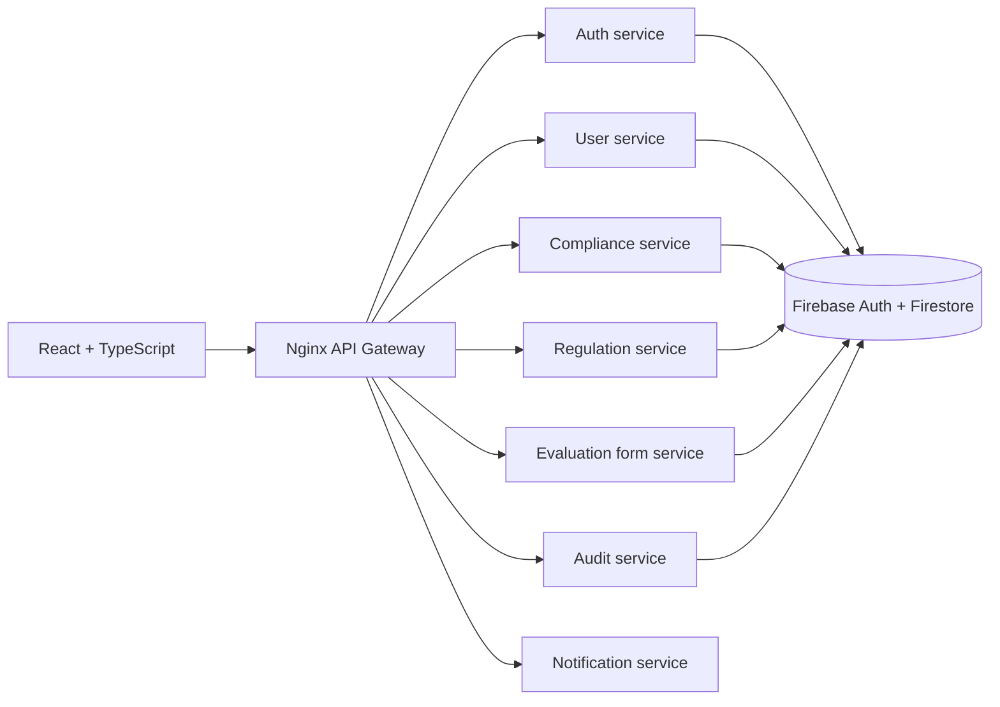
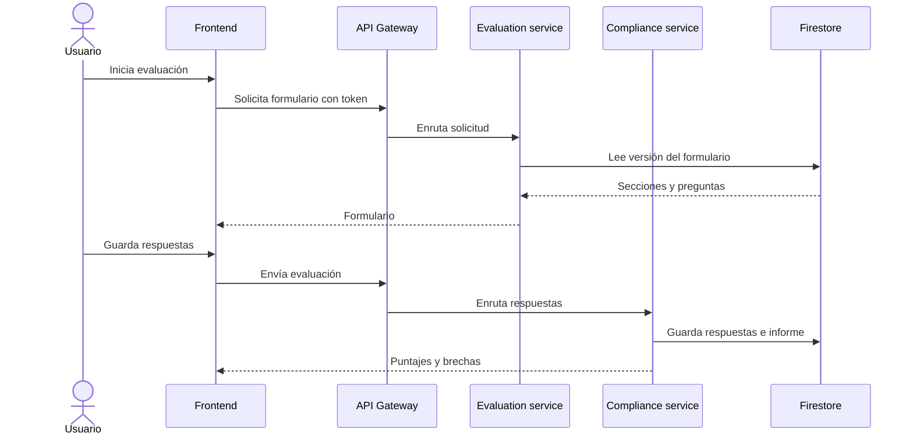

# Arquitectura de ISOlytics

## Responsabilidades

- **Frontend:** navegación, formularios, estado Redux, autenticación web y
  visualización de reportes.
- **API Gateway:** punto de entrada público y enrutamiento hacia servicios.
- **Auth:** registro, login, recuperación y validación de identidad.
- **Users:** perfiles, roles y datos relacionados con usuarios.
- **Regulation:** marcos, normas y requisitos evaluables.
- **Evaluation form:** formularios, secciones, preguntas y borradores.
- **Compliance:** respuestas, cálculo de puntajes e informes.
- **Audit:** auditorías y seguimiento por parte de evaluadores.
- **Notification:** notificaciones y correo opcional.
- **Firebase:** autenticación y persistencia compartida.

## Flujo principal

El Gateway mantiene las rutas públicas; los servicios no deben exponerse
directamente al navegador en producción.
